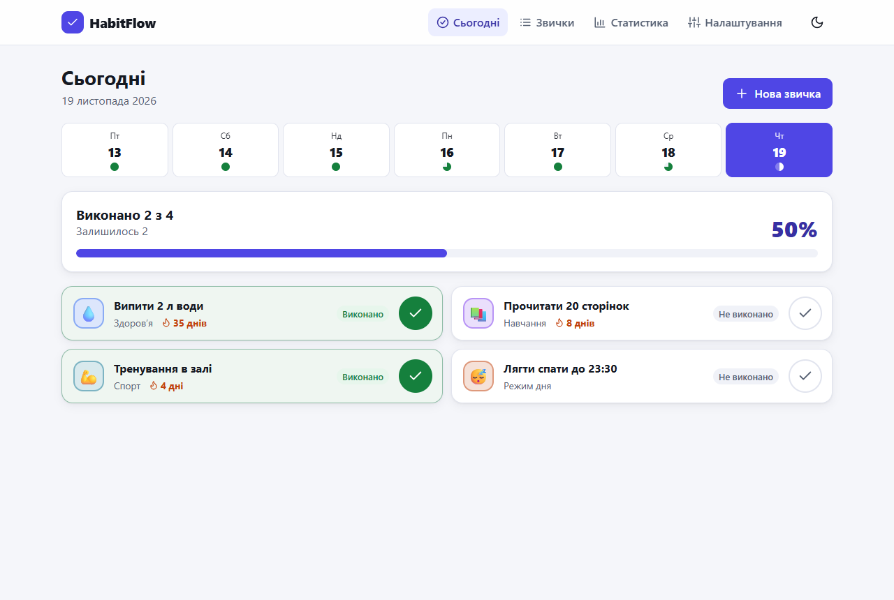
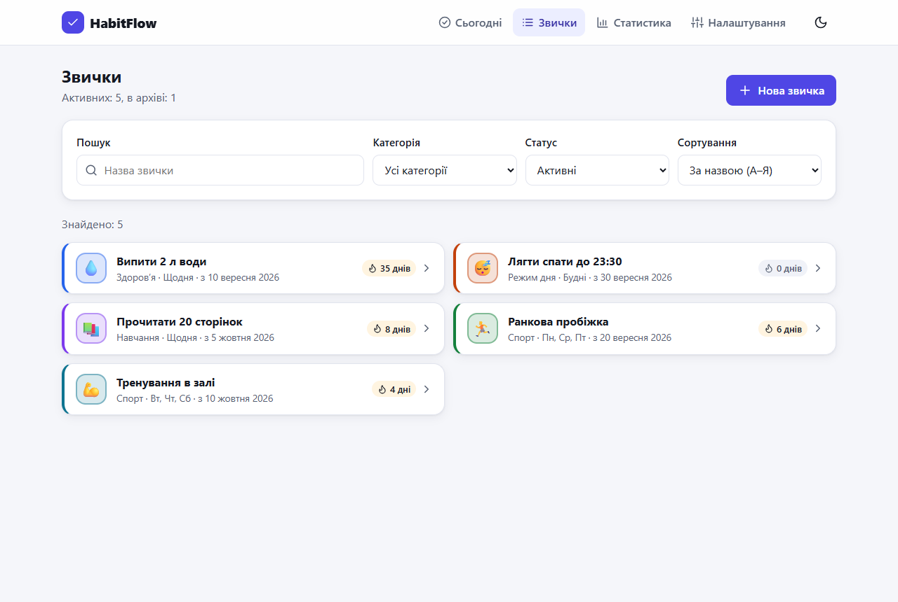
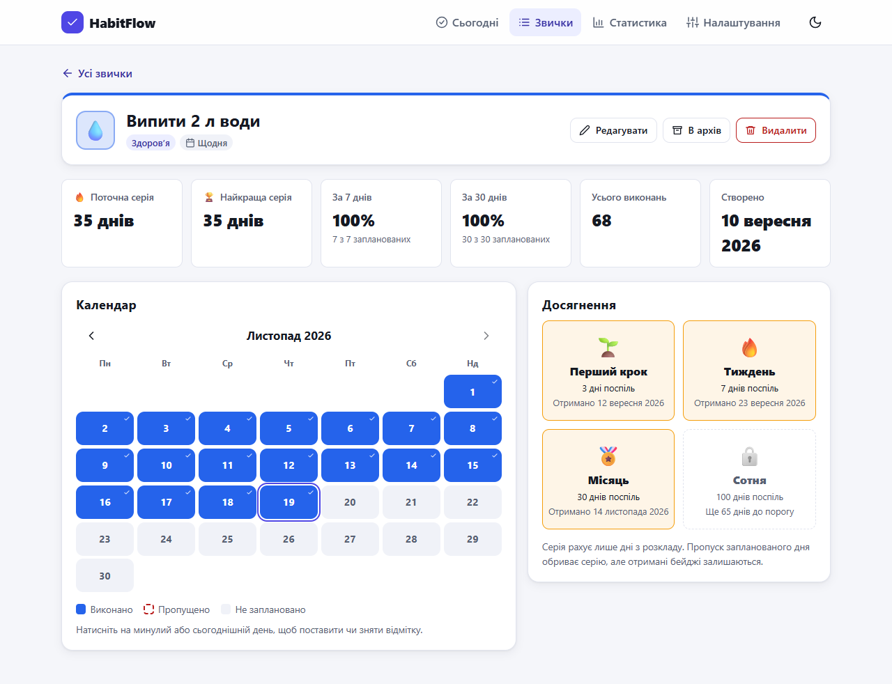
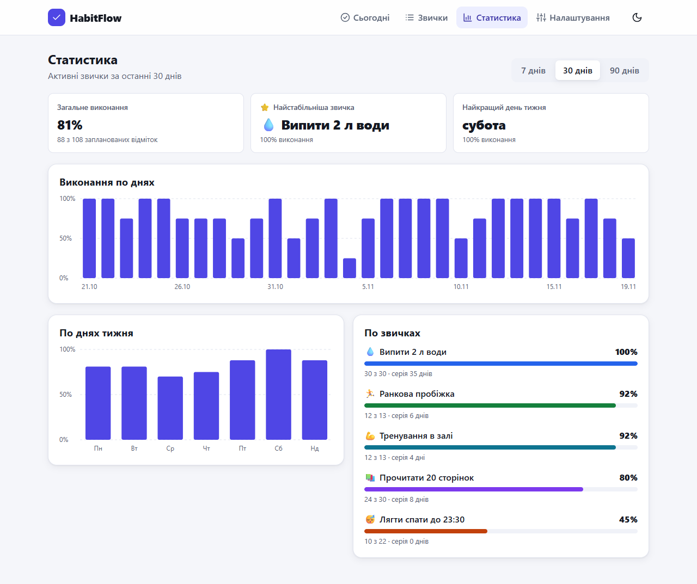
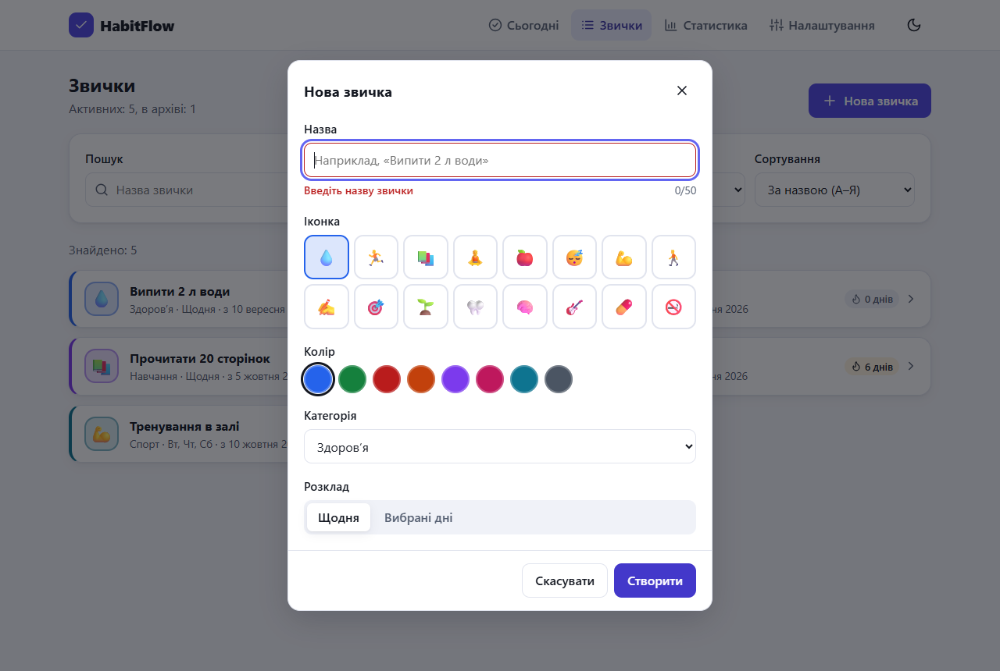
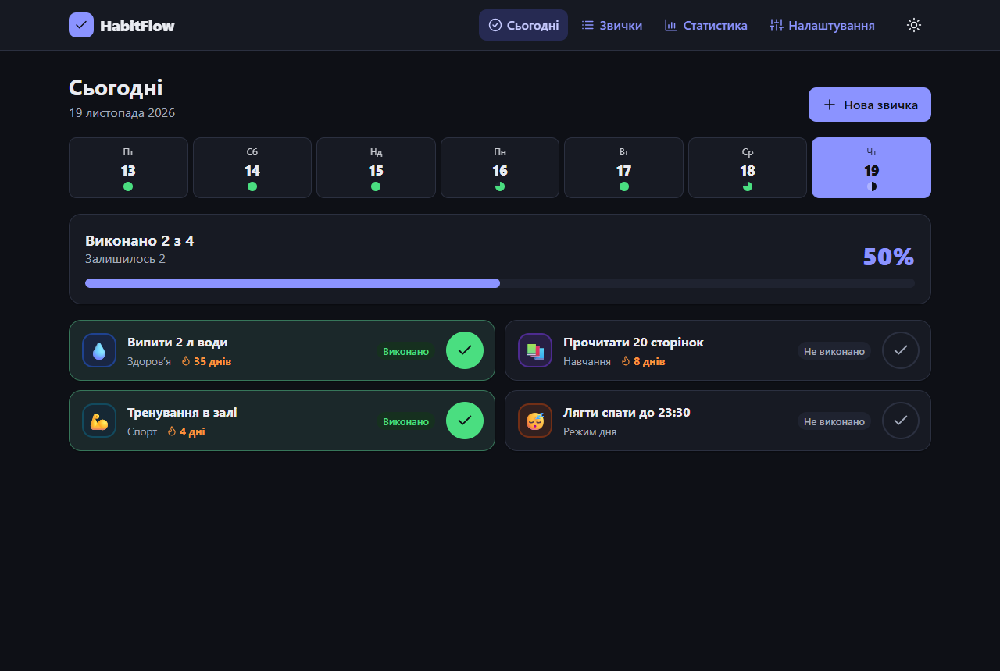
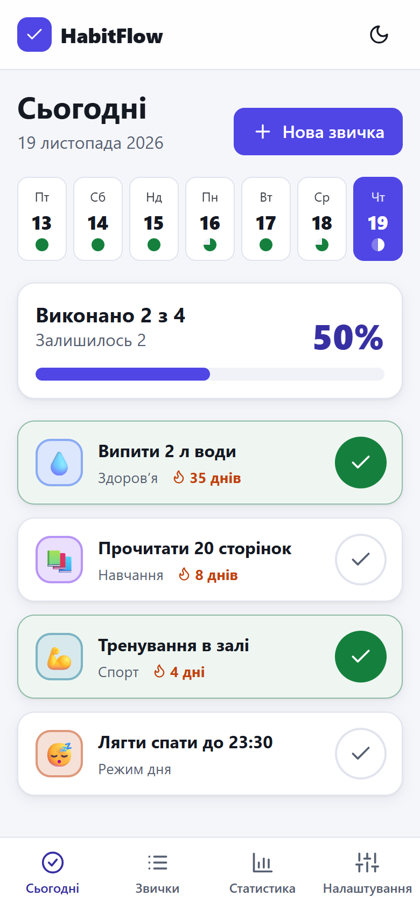
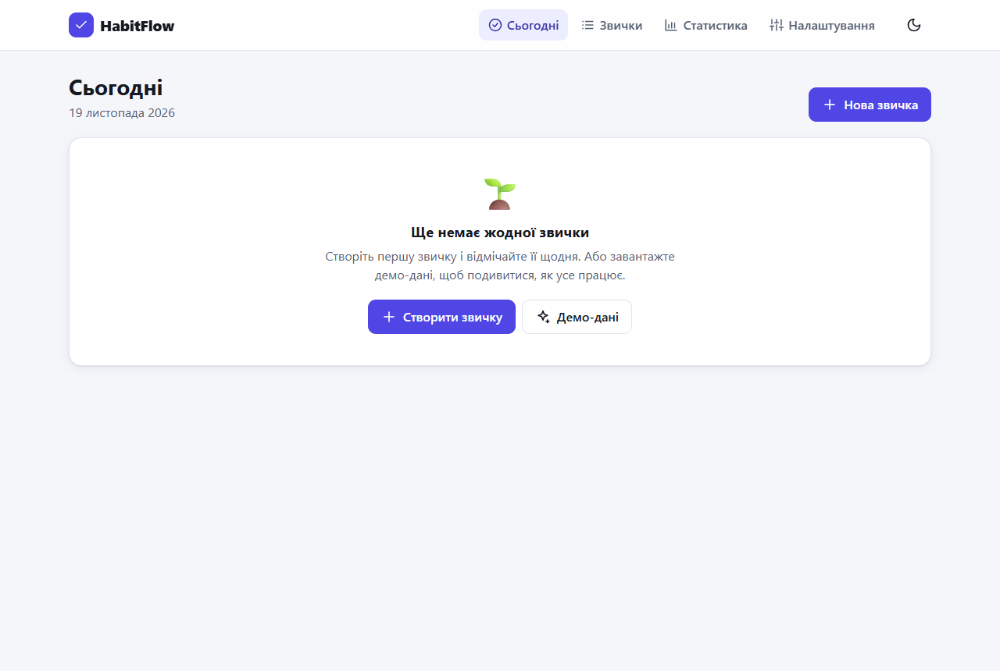
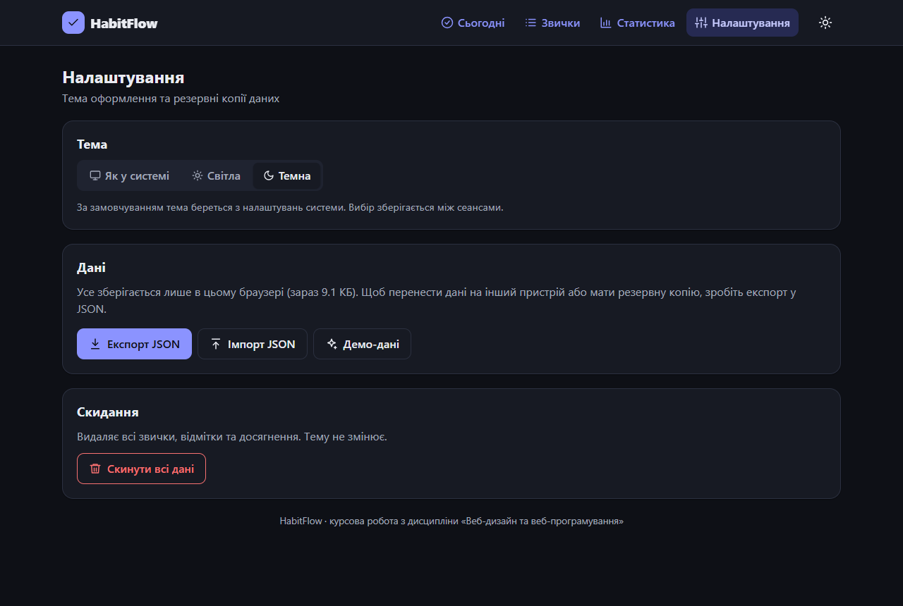

# HabitFlow — трекер звичок

Курсова робота з дисципліни «Веб-дизайн та веб-програмування».
Тема: розроблення вебзастосунку для відстеження звичок.
Виконав: Хаврук Назарій Олегович. Керівник: Миколайчук В. Р.

**Робоча версія:** https://nazariikhavruk.github.io/habit-tracker/

HabitFlow — адаптивний вебзастосунок, у якому користувач створює звички, щодня відмічає їх виконання, бачить серії днів поспіль, досягнення і статистику. Реєстрація не потрібна: усі дані зберігаються в браузері (localStorage), а резервну копію можна зробити через експорт у JSON.



## Можливості

| ID | Що вміє застосунок |
| --- | --- |
| F1 | Створення, редагування, архівування і видалення звички (з підтвердженням). Назва 2–50 символів, іконка, колір, категорія, розклад: щодня або вибрані дні тижня |
| F2 | Відмітка виконання на екрані «Сьогодні» (і за будь-який з останніх 7 днів) або в календарі звички для будь-якого минулого дня. Лічильник «Виконано X з Y», смуга прогресу і серія оновлюються одразу. Майбутній день відмітити не можна |
| F3 | Пошук за назвою, фільтр за категорією і статусом (активні, архів, усі), сортування за назвою, серією або датою створення. Порожній стан із кнопкою «Скинути фільтри» |
| F4 | Сторінка звички: місячний календар, поточна і найкраща серія, відсоток за 7 і 30 днів, кількість виконань, дата створення. Для неіснуючого id — «Звичку не знайдено» |
| F5 | Статистика за 7, 30 або 90 днів: графік по днях, розподіл по днях тижня, загальний відсоток, найстабільніша звичка, прогрес кожної звички |
| F6 | Автоматичні серії (лише дні з розкладу) і досягнення за 3, 7, 30 і 100 днів поспіль: сповіщення та бейдж у профілі звички |
| F7 | Світла і темна тема (за замовчуванням як у системі), експорт та імпорт JSON із перевіркою, скидання всіх даних із підтвердженням |

При першому запуску список порожній, і користувач додає власні звички. Щоб швидко подивитися, як працюють статистика й досягнення, є демонстраційний набір із 6 звичок та історією приблизно за 2 місяці: кнопка «Демо-дані» на порожньому екрані «Сьогодні» або в налаштуваннях. Скинути його можна там само в налаштуваннях.

## Технології

- Vue 3 (Composition API, `<script setup>`), Vite
- Vue Router: маршрути `/`, `/habits`, `/habits/:id`, `/stats`, `/settings` і сторінка 404
- Pinia: спільний стан звичок і відміток для кількох сторінок
- date-fns: робота з датами в локальному часі, українська локаль
- Власні SVG-графіки (без сторонніх бібліотек для діаграм)
- Vitest (unit-тести), ESLint + oxlint, Prettier
- GitHub Actions + GitHub Pages для розгортання

## Запуск

Потрібен Node.js 22.18 або новіший (перевірено на 24.22.1).

```
git clone https://github.com/NazariiKhavruk/habit-tracker.git
cd habit-tracker
npm install
npm run dev
```

Застосунок відкриється на `http://localhost:5173/`. У Windows PowerShell замість `npm` треба писати `npm.cmd` (PowerShell блокує `npm.ps1`).

| Команда | Що робить |
| --- | --- |
| `npm run dev` | сервер розробки |
| `npm test` | unit-тести (Vitest) |
| `npm run lint` | перевірка й автовиправлення коду (oxlint + ESLint) |
| `npm run format` | форматування Prettier |
| `npm run check` | лінтери без виправлень + тести (те саме запускає CI) |
| `npm run build` | збірка в папку `dist` |
| `npm run preview` | перегляд зібраної версії |

## Структура

```
src/
├── lib/                      логіка без Vue, покрита тестами
│   ├── dates.js              дати у форматі YYYY-MM-DD у локальному часі
│   ├── streaks.js            розклад, серії, відсоток виконання, досягнення
│   ├── stats.js              статистика за період
│   ├── storage.js            localStorage, перевірка схеми, експорт та імпорт
│   ├── demo.js               демонстраційні дані
│   ├── constants.js          категорії, іконки, кольори, пороги досягнень
│   ├── labels.js             підписи («Щодня», «5 днів»)
│   └── __tests__/            unit-тести
├── stores/
│   ├── habits.js             Pinia: звички, відмітки, дії над ними, автозбереження
│   └── ui.js                 Pinia: тема, сповіщення, фільтри списку
├── components/               картка звички, форма, календар, графік, модальне вікно,
│                             панель фільтрів, сповіщення, навігація тощо
├── views/                    сторінки: Today, Habits, HabitDetail, Stats, Settings, NotFound
├── router/index.js
├── assets/main.css           змінні тем, базові стилі
├── App.vue                   шапка, нижня панель, скелетон, банер помилки
└── main.js
```

## Модель даних

Дані лежать у `localStorage` під ключем `habitflow:data:v1`, тема — під `habitflow:theme`.

```json
{
  "version": 1,
  "habits": [
    {
      "id": "h-6f1c…",
      "name": "Випити 2 л води",
      "icon": "💧",
      "color": "#2563eb",
      "category": "health",
      "schedule": { "type": "days", "days": [1, 3, 5] },
      "createdAt": "2026-11-19",
      "archived": false,
      "achievements": [{ "threshold": 3, "unlockedAt": "2026-11-21" }]
    }
  ],
  "completions": [{ "habitId": "h-6f1c…", "date": "2026-11-19" }]
}
```

- `schedule.type`: `daily` або `days`; дні тижня за ISO: 1 = понеділок … 7 = неділя.
- Усі дати — рядки `YYYY-MM-DD` у локальному часі пристрою, тому їх можна порівнювати як рядки.
- Дані перевіряються за схемою (`validateData` у `src/lib/storage.js`) і під час читання з localStorage, і під час імпорту.

## Як рахується серія

- Враховуються лише дні з розкладу звички: для «Пн, Ср, Пт» вівторок серію не перериває.
- Пропуск запланованого дня обриває серію.
- Сьогоднішній день, який ще не відмічено, серію не обриває (день ще не закінчився).
- Найкраща серія — найдовший відрізок за всю історію.
- Досягнення видається, коли серія вперше доходить до 3, 7, 30 або 100 днів. Бейдж зберігається у звичці і не зникає, навіть якщо серія потім обірветься.

Код: `src/lib/streaks.js`, тести: `src/lib/__tests__/streaks.spec.js`.

## Стани та помилки

| Ситуація | Що бачить користувач |
| --- | --- |
| Ініціалізація | скелетон сторінки |
| Немає звичок | порожній стан із кнопками «Створити звичку» і «Демо-дані» |
| Нічого не знайдено за фільтрами | порожній стан із кнопкою «Скинути фільтри» |
| Немає даних для статистики | порожній стан із посиланням на звички |
| Пошкоджений запис у localStorage | банер з поясненням; копія запису зберігається під `habitflow:data:corrupted-backup` |
| Невалідний файл імпорту | повідомлення з причиною (наприклад, «Звичка №1: назва має містити від 2 до 50 символів») |
| Переповнене сховище | сповіщення «Сховище переповнене» з порадою зробити експорт |
| Невідомий маршрут | сторінка 404 |

## Доступність

- Семантична розмітка: `header`, `nav`, `main`, `section`, `form`, `button`, `dialog`.
- Усі поля мають `label`, помилки форми пов'язані з полем через `aria-describedby`.
- Повна клавіатурна навігація, видимий фокус, посилання «Перейти до вмісту», Esc закриває модальні вікна.
- Сповіщення озвучуються через `aria-live`.
- Стан звички передається не лише кольором: текст «Виконано / Не виконано», заповнена кнопка з галочкою, `aria-pressed`.
- Графіки мають приховану таблицю з тими самими даними для екранних дикторів.
- Анімації вимикаються при `prefers-reduced-motion`.

## Розгортання

Після кожного push у `main` GitHub Actions (`.github/workflows/deploy.yml`) запускає лінтери й тести, збирає проєкт і публікує папку `dist` на GitHub Pages. Сайт лежить у підпапці `/habit-tracker/`, тому у `vite.config.js` для збірки задано `base`. GitHub Pages не знає маршрутів Vue, тому пряме посилання на кшталт `/habit-tracker/habits/…` потрапляє на `public/404.html`. Ця сторінка одразу перенаправляє на `/habit-tracker/?/habits/…`, а скрипт в `index.html` повертає правильну адресу через `history.replaceState`, після чого маршрут відкриває Vue Router (прийом spa-github-pages).

## Перевірка

- Unit-тести: 33 тести для серій, статистики, перевірки даних, експорту та імпорту.
- Сценарії перевірено в Google Chrome і Microsoft Edge: створення, валідація форми, відмітки, досягнення, фільтри, архів, видалення, 404, експорт → імпорт без втрат, невалідний імпорт, пошкоджений localStorage, переповнене сховище.
- Ширини 360, 768 і 1280 px: без горизонтального прокручування; на мобільному нижня панель навігації, на десктопі меню в шапці.

## Обмеження

- Дані зберігаються лише в одному браузері (ліміт localStorage близько 5 МБ), синхронізації між пристроями немає. Для перенесення використовуйте експорт та імпорт JSON.
- Реєстрації, авторизації та серверної частини немає за умовами ТЗ.
- Зовнішні API не використовуються, тому ключів і `.env` у проєкті немає.

## Скриншоти

| Звички | Сторінка звички |
| --- | --- |
|  |  |

| Статистика | Нова звичка (помилка валідації) |
| --- | --- |
|  |  |

| Темна тема | Мобільна версія |
| --- | --- |
|  |  |

| Перший запуск (порожній список) | Налаштування (темна тема) |
| --- | --- |
|  |  |
